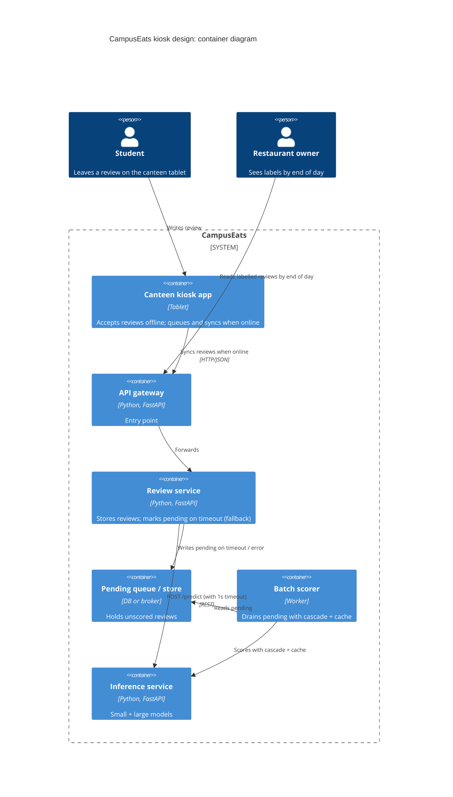

# Task 4: Deployment topologies and trade-offs

**Name / ชื่อ:** (Thanabul Parodom)

**Student ID / รหัสนิสิต:** (6872036421)

This is **individual work**: each student completes and submits their own copy, in their own fork.

**Scenario (A, B or C) / Scenario ที่เลือก:** **B**

Choose **one** scenario below. If the last digit of your student ID is odd, take A or B; if it is even, take B or C. Use your measurements from Tutorial 6 as evidence: cite run names from `results/runs.csv`. Answer in Thai or English.

Facts that hold in every scenario:
- The large model serves at most **20 calls per second** (4 calls at once × about 200 ms each), and every call costs money.
- The small model is fast and cheap enough to run anywhere, including inside the review service or on a kiosk, but it is much less accurate on its own.

## Scenarios

**B. Canteen kiosk.** A tablet in each canteen lets students leave a review on the spot. However, the canteen Wi-Fi is poor: the tablets lose their connection several times a day, for minutes at a time. The system must accept every review, even while a tablet is offline. Restaurant owners need the labels **by the end of the day**.

## Topologies and patterns to choose from

| | Topology | Where the model runs |
|---|---|---|
| T1 | Model as a service, synchronous | Inference service, called for each review (today's baseline) |
| T2 | Model as a library | Inside the review service, or on the device |
| T3 | Hybrid | Small model locally, large model as a remote service |
| T4 | Asynchronous / batch | Reviews are queued or stored, and scored later in bulk |

Combine one topology with any of the patterns from Tutorial 6: **fallback**, **cascade** and **cache**.

## 1. Quality requirements

The three most important quality requirements for your scenario, each with a number where possible.

| # | Quality | Requirement |
|---|---|---|
| 1 | Availability / durability | Every review is accepted and stored even when the tablet is offline (0 review loss) |
| 2 | Timeliness | All reviews have a label by end of day (batch window ≤ ~12–16 h) |
| 3 | Accuracy | Labelled reviews ≥ 90% correct (QR3), preferably close to large-model accuracy |

## 2. Design / การออกแบบ

**Topology:** T4 Asynchronous / batch, combined with **fallback** (local accept-and-queue) and optional **cascade** when the batch job runs online.

On the tablet / edge: store the review locally when offline; when connectivity returns, post it to the review service. The review service never blocks the user on inference: it either scores quickly or marks `pending` (fallback pattern from Task 1). Overnight (or continuous low-priority) a batch worker drains pending reviews through the inference service using cascade (threshold 0.7) + cache to keep cost and load low.

## 3. Evidence / หลักฐาน

Which runs support your choice? Show the numbers and, for scenario A, the capacity arithmetic.

| Run | What it shows |
|---|---|
| t1-after | Fallback turns hangs into `pending` (errors=0, pending≈18). Reviews are never lost — required for offline kiosks. |
| t0-large vs t0-small | Pure small is only 72.5% accurate (fails QR3); pure large is 93.5% but expensive and capacity-limited. Batch can afford large/cascade without real-time pressure. |
| t2-0.7 | Cascade at 0.7 keeps accuracy 93.0% while using only 53% large calls — good for the overnight batch to minimise cost. |
| t3-cache | Cache further cuts large calls (38%) and latency when the same texts reappear — useful if many short, repeated kiosk comments. |

No peak real-time capacity problem: scoring is deferred, so the 20 large-calls/s limit is not a constraint during the day.

## 4. ADR

**Title:** Use asynchronous batch scoring with fallback for canteen kiosk reviews

**Status:** Proposed

**Context:**
Canteen tablets have unreliable Wi-Fi and must accept every review immediately. Labels are only needed by end of day. The large model is accurate but slow, expensive and capacity-limited (20 calls/s). Synchronous model-as-a-service (T1) would drop reviews when offline or when inference hangs.

**Decision:**
Adopt topology **T4 (asynchronous / batch)**:
- Edge/kiosk buffers reviews offline and syncs when possible.
- Review service uses the **fallback** pattern (1 s timeout → `pending`) so a hung or unreachable inference service never loses a review.
- A batch worker scores pending reviews later with **cascade (threshold 0.7)** and **cache** to meet ≥90% accuracy at lower cost.

**Consequences:**
- Positive:
  - Zero review loss under offline or inference failure (FR4 + availability).
  - No real-time dependence on large-model capacity.
  - Cost controlled by cascade + cache (see t2-0.7, t3-cache).
- Negative:
  - Labels are not real-time (owners wait until end of day).
  - Need durable storage/queue and a reliable batch job.
  - Cache must be invalidated when models are updated.

**Alternatives considered:**
- **T1 synchronous model-as-a-service:** Rejected because offline tablets and hanging inference would cause lost reviews or long client waits (t1-before behaviour).
- **T2 model-as-a-library (small model only on device):** Rejected because accuracy 72.5% (t0-small) fails the 90% requirement.
- **T3 hybrid real-time cascade:** Possible for online periods, but still fails when the tablet is offline; the batch path is still required, so pure T4 + fallback is simpler and sufficient for the “by end of day” goal.
